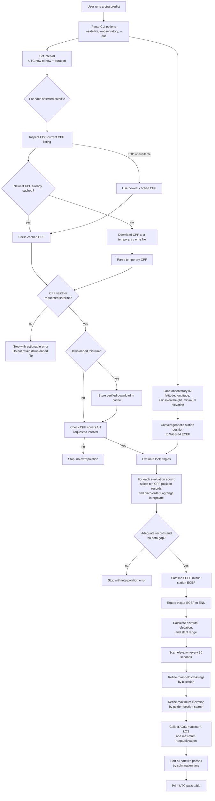

# Arctra software flow

This chart describes the current `arctra predict` path: from a command-line
request to geometric pass predictions. All reported directions and ranges are
instantaneous geometric quantities; this is not telescope or laser-control
software.

## CPF acceptance checks

Before a CPF can be used, Arctra parses it and confirms that it is CPF v2 and
that its header target name, ILRS ID, and NORAD ID match the selected satellite.
The parser currently supports only passive Earth-orbiting targets in CPF
reference frame `0`: geocentric true body-fixed. It rejects other target types
and frames rather than mixing incompatible coordinates.

## Deliberate limits

- A CPF must cover the full requested interval; Arctra does not extrapolate.
- Station conversion uses WGS 84. The supplied station coordinates must be
  appropriate for the CPF terrestrial frame and epoch for precision work.
- The output omits light-time iteration, atmosphere/refraction, station
  displacement, instrument calibration, safety interlocks, and any control
  interface.
