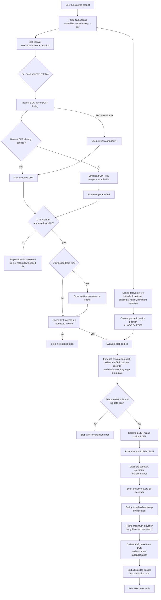
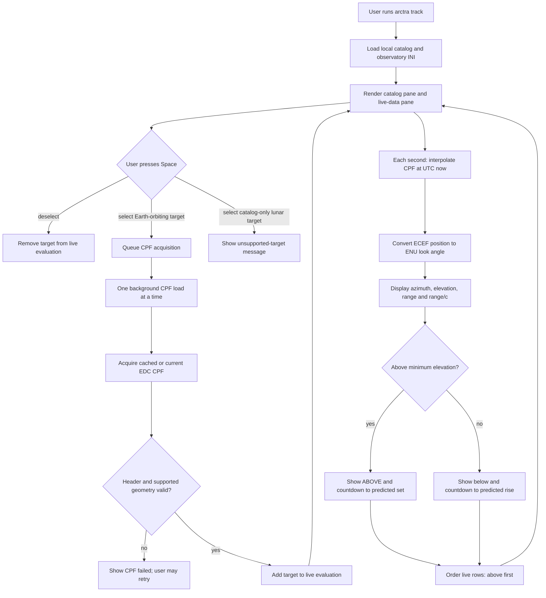

# Arctra software flow

This document describes the current `arctra predict` and `arctra track` paths.
All reported directions and ranges are instantaneous geometric quantities; this
is not telescope or laser-control software.

## CPF acceptance checks

Before a CPF can be used, Arctra parses it and confirms that it is CPF v2 and
that its header target name, ILRS ID, and NORAD ID match the selected satellite.
The parser currently supports only passive Earth-orbiting targets in CPF
reference frame `0`: geocentric true body-fixed. It rejects other target types
and frames rather than mixing incompatible coordinates.

## Live tracker flow

`arctra track --observatory FILE` keeps the local catalog and selected target
data in one terminal view. The catalog is checked in with the application;
typing/searching in this view does not perform an online satellite lookup.

The next threshold event is found with the same CPF pass-search/refinement
logic as `predict`, then cached until it occurs. The display refresh is live;
the ephemeris is the downloaded CPF, not real-time spacecraft telemetry.

## Deliberate limits

- A CPF must cover the full requested interval; Arctra does not extrapolate.
- Station conversion uses WGS 84. The supplied station coordinates must be
  appropriate for the CPF terrestrial frame and epoch for precision work.
- The output omits light-time iteration, atmosphere/refraction, station
  displacement, instrument calibration, safety interlocks, and any control
  interface.
- Live-track microseconds are geometric vacuum range divided by the speed of
  light. They are not corrected one-way or two-way SLR timing.
- The current UTC representation cannot preserve a distinct leap-second label;
  do not use this implementation to predict across a leap second.
