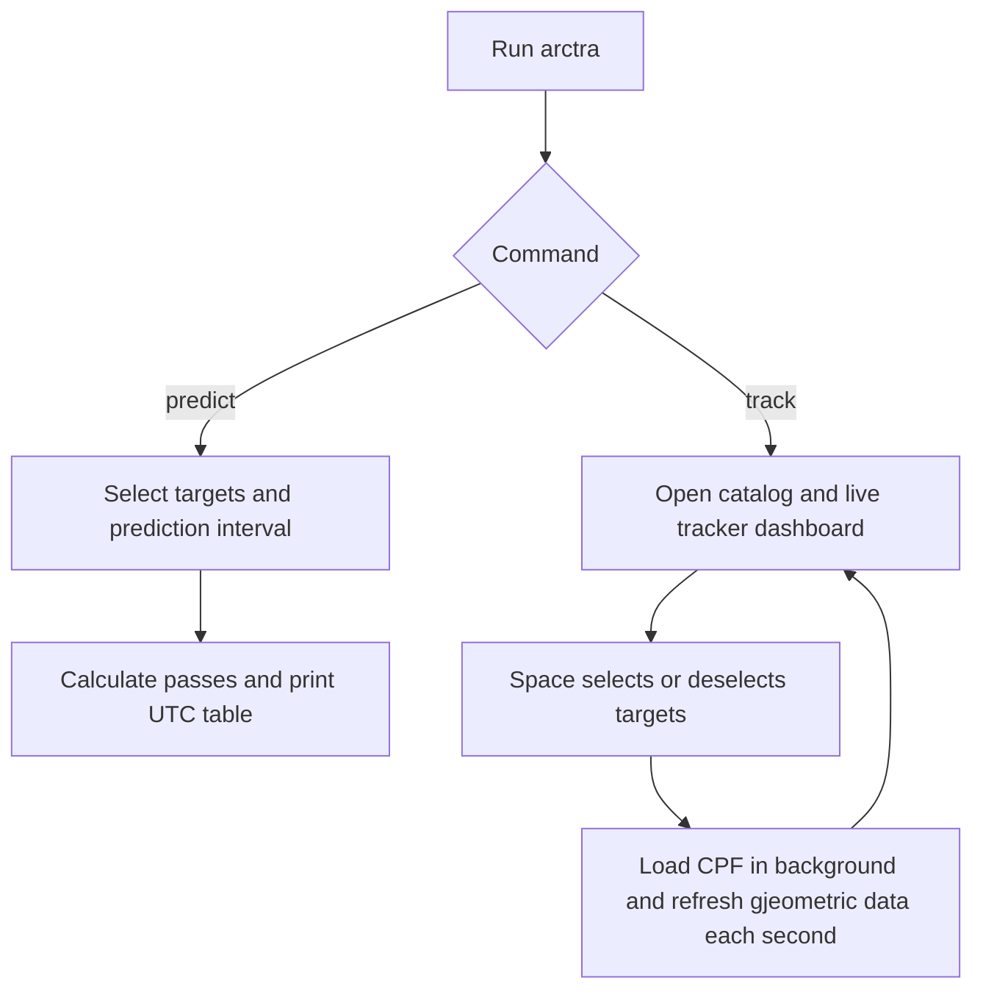
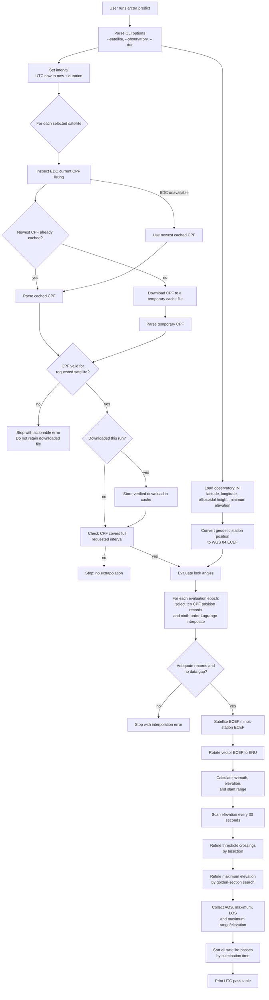
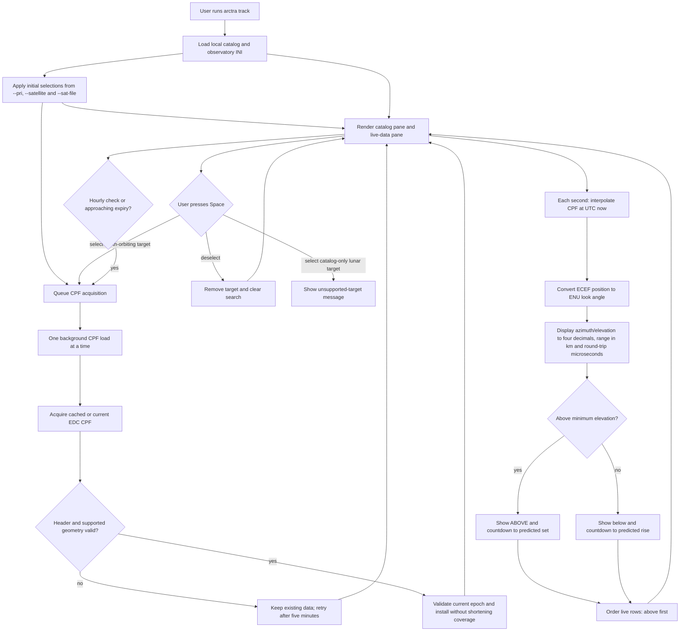

# Arctra software flow

This document describes the current `arctra predict` and `arctra track` paths.
All reported directions and ranges are instantaneous geometric quantities; this
is not telescope or laser-control software.

## Choose a command

| Command | Purpose | Flow |
| --- | --- | --- |
| `arctra predict` | Print a pass table for a requested interval | [Predict flow](#predict-flow) |
| `arctra track` | Open the interactive live terminal dashboard | [Track flow](#track-flow) |



## Predict flow

```bash
./build/release/arctra predict --satellite lageos1 --observatory nyal.ini --dur 24h
```



## CPF acceptance checks

Before a CPF can be used, Arctra parses it and confirms that it is CPF v2 and
that its header target name, ILRS ID, and NORAD ID match the selected satellite.
The parser currently supports only passive Earth-orbiting targets in CPF
reference frame `0`: geocentric true body-fixed. It rejects other target types
and frames rather than mixing incompatible coordinates.

## Track flow

Open the interactive dashboard with:

```bash
./build/release/arctra track --observatory nyal.ini
```

Preselect targets from the current directory's `priorities.sat` file with:

```bash
./build/release/arctra track --pri --observatory nyal.ini
```

Use `--satellite lageos1,lageos2` or `--sat-file FILE` for other initial
selections; these can be combined with `--pri`. An interactive terminal is
required. Type to find a catalog target, press Space to select/deselect it,
and press `q` or Escape to quit. Space clears the search and preserves the
cursor. Tab switches focus between catalog and live data; the active header is
marked `▶`. In the live pane the current target row is highlighted instead of
the header. Arrows, Page Up/Down, and Home/End navigate the
focused pane. The live pane scrolls independently and reports its visible range,
including queued and failed loads. Search and Space operate in the catalog;
live ordering continues to update while retaining the scroll offset.

`arctra track [--pri] --observatory FILE` keeps the local catalog and selected
target data in one terminal view. The catalog is checked in with the
application; typing/searching in this view does not perform an online satellite
lookup.

With `--pri`, Arctra reads `priorities.sat` from the current directory and
marks its Earth-orbiting entries selected before rendering the dashboard. Their
CPF loads are then queued in the background just like a Space selection.



The next threshold event is found with a 30-second scan and bisection, returning
at the first crossing and stopping at the earlier of the CPF intended end and
the final position record. Crossings are refined to a 10 ms bracket. A complete
rise/set interval between scan samples can be missed. Events are cached until
they occur; no-event results and failures persist until CPF replacement or reselection. A successful
search without an event displays `no rise within CPF coverage` (also currently
used for continuously above-threshold targets). An exception produces
`timer unavailable`, independently of the current look-angle calculation.
Space clears the typed search after toggling, preserving the cursor.
The display refresh is live; the ephemeris is the downloaded CPF, not real-time
spacecraft telemetry. The `μs (RT)` column is `2 * range / c` in microseconds.

## Automatic CPF refresh

Selected targets check the current EDC listing hourly, or 30 minutes before the
loaded CPF's usable end (minimum of header end and final position record).
Checks near expiry and failed attempts are scheduled five minutes apart to
avoid request loops. All loads share one background worker, so queueing can
postpone a check. Initial failures also retry; deselection removes scheduled work.

Header identity, supported geometry, and current-epoch interpolation are checked
before installation. The loaded prediction remains available during retrieval
or failures. A file with shorter coverage does not replace it. Accepted
replacements reset the next-crossing cache. Cached fallback is marked as an
unsuccessful online check and schedules a five-minute retry. Current positions
become unavailable when interpolation coverage expires. The focused-target
footer reports expiry and refresh/next-check status, even on narrow displays.

## Deliberate limits

- `predict` requires CPF coverage of the full requested interval. `track`
  requires coverage of each evaluated epoch and searches for the next crossing
  only within available coverage. Arctra does not extrapolate.
- Station conversion uses WGS 84. The supplied station coordinates must be
  appropriate for the CPF terrestrial frame and epoch for precision work.
- The output omits light-time iteration, atmosphere/refraction, station
  displacement, instrument calibration, safety interlocks, and any control
  interface.
- Live-track microseconds are twice the geometric vacuum range divided by the
  speed of light, labelled `μs (RT)`. They are not corrected SLR timing.
- The current UTC representation cannot preserve a distinct leap-second label;
  do not use this implementation to predict across a leap second.

Visibility and prediction health have separate coloured labels: green `ABOVE`
and grey `below` refer to the configured minimum-elevation threshold. CPF status
is green `CPF OK` with no expiry countdown, yellow `CPF EXPIRING hh:mm:ss` within
30 minutes of usable expiry, and red `CPF EXPIRED` at expiry. Hours can exceed
24. Unavailable positions show `UNKNOWN` and omit current angles and range.
Status colour resets preserve the active row's reverse-video highlight.
